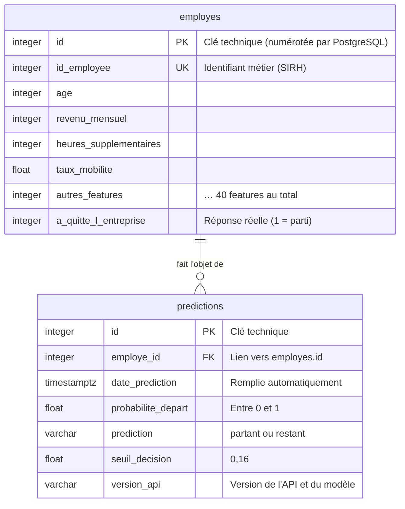
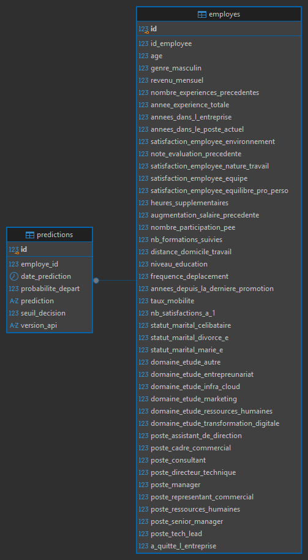

# Base de données

Base PostgreSQL `projet5`, créée par `scripts/create_db.py`. Elle contient deux tables :

- `employes` : le dataset du projet 4 ;
- `predictions` : l'historique de chaque appel à l'API.

## Schéma



Schéma complet généré par DBeaver, avec les 40 colonnes de features :



## Table `employes`

Une ligne par employé (1 470 lignes), insérée une seule fois à partir de `data/employes.csv`.

| Colonne | Type | Description |
|---|---|---|
| `id` | entier, clé primaire | Clé technique, numérotée automatiquement |
| `id_employee` | entier, unique | Identifiant métier de l'employé, reçu par l'API |
| 40 colonnes de features | entier (`taux_mobilite` : décimal) | Données déjà nettoyées et encodées au projet 4 |
| `a_quitte_l_entreprise` | entier (0/1) | Réponse réelle, conservée pour les analyses |

Les noms des features sont **normalisés pour SQL** (minuscules, sans accents ni caractères spéciaux),
par exemple `statut_marital_Divorcé(e)` → `statut_marital_divorce_e`. Seuls les noms changent, pas les
valeurs. La correspondance inverse est appliquée automatiquement avant chaque prédiction
(`NOMS_MODELE` dans `src/projet5/base_de_donnees.py`).

## Table `predictions`

Une ligne par appel réussi à `/predict/{id_employee}`.

| Colonne | Type | Description |
|---|---|---|
| `id` | entier, clé primaire | Clé technique |
| `employe_id` | entier, clé étrangère → `employes.id` | **Entrée** du modèle : l'employé concerné |
| `date_prediction` | date et heure (avec fuseau) | Remplie automatiquement par PostgreSQL |
| `probabilite_depart` | décimal | **Sortie** : probabilité de départ (contrainte : entre 0 et 1) |
| `prediction` | texte | **Sortie** : `partant` ou `restant` (contrainte : l'une de ces deux valeurs) |
| `seuil_decision` | décimal | Seuil appliqué (0,16) |
| `version_api` | texte | Version de l'API, donc du modèle, ayant produit la prédiction |

Les requêtes en erreur (employé inconnu, clé invalide) ne sont pas enregistrées.

## Volume et performances

La table `employes` est fixe (une ligne par employé). La table `predictions` grossit à chaque appel de
l'API : sa structure est pensée pour rester efficace avec le volume.

| Index | Créé par | Utilité |
|---|---|---|
| `employes_pkey` (`id`) | Clé primaire (automatique) | Jointures avec `predictions` |
| `employes_id_employee_key` (`id_employee`) | Contrainte d'unicité (automatique) | Recherche de l'employé à chaque appel de l'API |
| `predictions_pkey` (`id`) | Clé primaire (automatique) | Accès direct à une prédiction |
| `ix_predictions_employe_id` | `index=True` | Historique d'un employé, jointures (PostgreSQL n'indexe pas automatiquement les clés étrangères) |
| `ix_predictions_date_prediction` | `index=True` | Analyses par période (activité par jour, dernières prédictions) |

Autres choix favorables au volume : types compacts (entiers pour les features et les clés), aucune
donnée dupliquée (les features ne sont stockées qu'une fois, dans `employes`).

Pistes pour de très gros volumes : partitionnement de `predictions` par mois, purge ou archivage des
prédictions anciennes selon une durée de conservation définie (exigence RGPD).

## Clé technique et identifiant métier

Chaque table possède sa propre **clé technique** `id`, distincte de l'**identifiant métier**
`id_employee` venu du SIRH.

- `predictions.employe_id` pointe vers la clé technique `employes.id`, et **non** vers `id_employee`.
  Exemple : l'employé `id_employee = 1273` a la clé technique `id = 912`.
- La table `predictions` ne contient donc **aucun identifiant métier** : relier une prédiction à
  une personne impose de passer par la table `employes`.
- **Intérêt (RGPD)** : pour limiter l'accès aux données personnelles, il suffit de restreindre ou de
  pseudonymiser la table `employes`, sans toucher à l'historique des prédictions.

Pour retrouver l'identifiant métier d'une prédiction :

```sql
SELECT p.id, e.id_employee, p.probabilite_depart, p.prediction
FROM predictions p
JOIN employes e ON e.id = p.employe_id;
```

## Exemples d'entrées en base

`docs/exemples_predictions.csv` contient un échantillon de prédictions enregistrées : les entrées
(employé et quelques-unes de ses features) et les sorties du modèle. Ce fichier est généré par :

```bash
uv run python scripts/exporter_exemples.py
```

## Requêtes d'analyse

Le fichier `scripts/requetes_analyse.sql` regroupe les requêtes de suivi présentées dans la section
« Besoins analytiques » du README.